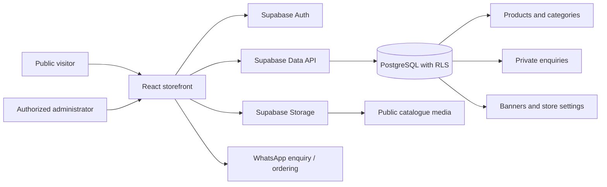
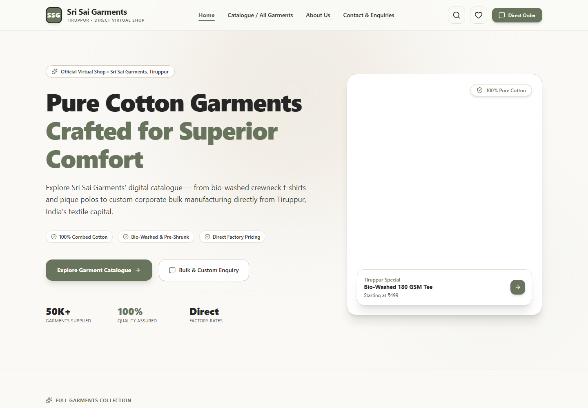
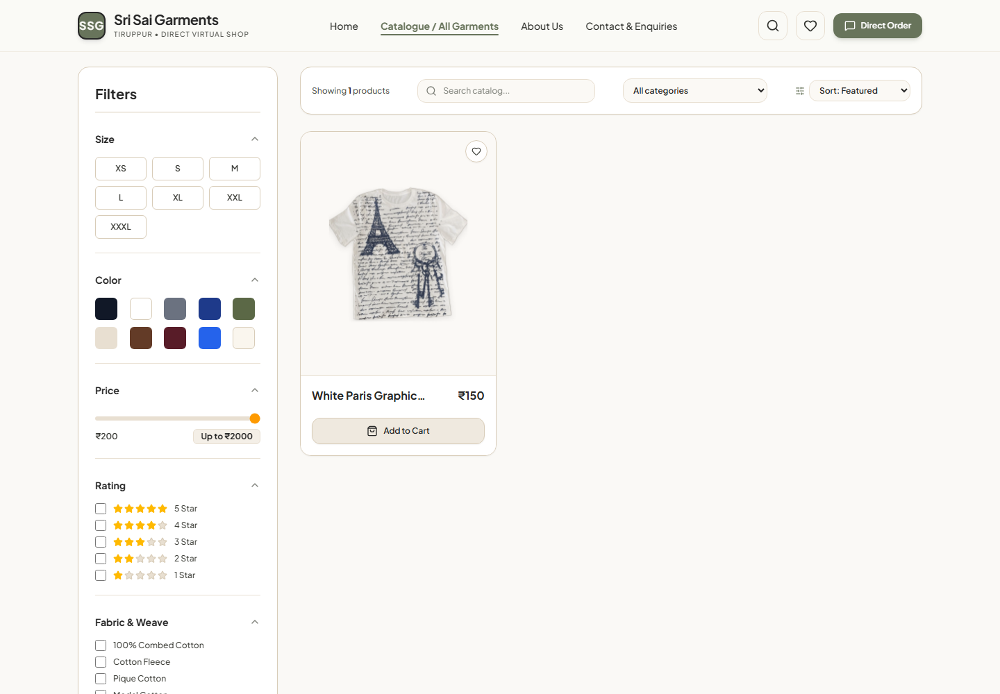
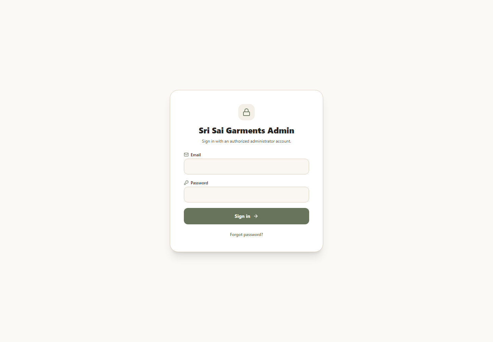
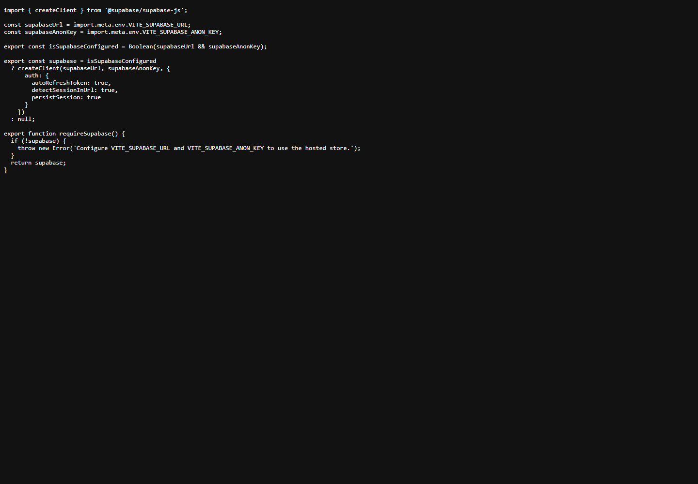

# Sri Sai Garments Storefront and Admin Panel

A responsive garment catalogue and enquiry website for Sri Sai Garments, with an administrator workspace for maintaining the catalogue and store content. The public storefront preserves WhatsApp ordering while saving submitted enquiries to Supabase when a project is configured.

> **Credential safety:** Never add `.env`, passwords, private customer information, Supabase service-role/secret keys, or production tokens to source control, screenshots, or documentation. The checked-in `.env.example` contains placeholders only. The public anon/publishable key is intended for browser use, but must always be protected by database Row Level Security (RLS).

## Table of contents

- [1. Problem Statement](#1-problem-statement)
- [2. Solution Implemented](#2-solution-implemented)
- [3. Technical Architecture](#3-technical-architecture)
- [4. System Design](#4-system-design)
- [5. Screenshots](#5-screenshots)
- [6. Local Setup](#6-local-setup)
- [7. Supabase and Administrator Setup](#7-supabase-and-administrator-setup)
- [8. Security and Operations](#8-security-and-operations)
- [9. Validation and Known Limitations](#9-validation-and-known-limitations)

## 1. Problem Statement

The original storefront presented garment products and WhatsApp enquiry options, but catalogue and enquiry data were maintained in browser-local storage. That made updates difficult to share across devices and did not provide a reliable central administration workflow. The former demonstration login was not suitable for production, and customer enquiries needed to remain private from public visitors.

The project therefore needed to:

- Provide a clear online catalogue and preserve direct WhatsApp enquiries.
- Let authorized staff maintain product and store information without editing source files.
- Store products and enquiries centrally, with the correct public-versus-administrator access boundaries.
- Support a safe development experience when the hosted backend is not configured.

## 2. Solution Implemented

The application combines a public React storefront with a protected administrator workspace backed by Supabase.

### Public storefront

- Home, catalogue, product detail, about, and contact pages.
- Product search/filter/sort, product imagery, categories, and featured items.
- Wishlist and direct WhatsApp ordering/enquiry links.
- Editable business contact details, banners, footer/about content, and SEO metadata.
- Contact form writes the enquiry before opening WhatsApp; a database error is surfaced rather than reporting a false success.

### Administrator workspace

- Supabase email/password sign-in, session persistence, role lookup, sign-out, and password reset.
- Dashboard metrics and latest product/enquiry summaries.
- Product create/edit/publish/draft/inactive workflows with image gallery upload, ordering, and removal.
- Category and subcategory management with visibility controls.
- Enquiry status and private-note management, filtering/pagination, and CSV export.
- Homepage banner and store information/settings management.

### Development preview

When Supabase environment values are absent, the site displays a preview warning, uses checked-in sample products, and keeps development enquiries in the current browser. Administrator sign-in is disabled. This mode is for local UI work only; it is not a production data store.

## 3. Technical Architecture

### Stack

| Layer | Technology | Responsibilities |
|---|---|---|
| Browser UI | React 19, React Router 7 | Storefront pages, admin screens, navigation, and client-side forms |
| Build and development | Vite 8 | Local development server and optimized production bundle |
| Styling and icons | Tailwind CSS 4, Lucide React | Responsive visual system and interface icons |
| Authentication | Supabase Auth | Email/password login, persistent sessions, password recovery |
| Data API | Supabase PostgREST / PostgreSQL | Catalogue, categories, enquiries, banners, settings, constraints, and RLS |
| Media | Supabase Storage | Public delivery of approved catalogue images; administrator-only writes |
| Hosting | Static frontend hosting + Supabase project | Deploy the built frontend and configure the Supabase project separately |

### Architecture overview



The browser uses only the project URL and public anon/publishable key. PostgreSQL policies and Storage policies are the authorization boundary; hiding a route in React is not considered a security control. A service-role key is never needed by or permitted in the frontend.

### Main source areas

| Path | Purpose |
|---|---|
| `src/App.jsx` | Application providers, route table, and storefront/admin layout selection |
| `src/pages/` | Public pages and administrator screens |
| `src/components/` | Shared storefront, product, and admin UI components |
| `src/context/AuthContext.jsx` | Supabase session lifecycle and administrator profile verification |
| `src/context/StoreContext.jsx` | Storefront settings and SEO metadata state |
| `src/services/supabase.js` | Supabase client setup and missing-configuration guard |
| `src/services/productService.js` | Product data access and development-preview fallback |
| `src/services/enquiryService.js` | Enquiry persistence, admin queries, summary counts, and CSV data access |
| `src/services/storeService.js` | Categories, banners, settings, and catalogue media operations |
| `supabase/migrations/` | PostgreSQL schema, constraints, triggers, RLS and Storage policies |

## 4. System Design

### Routes and access

| Route | Access | Purpose |
|---|---|---|
| `/` | Public | Store homepage, featured products, and active banners |
| `/products` | Public | Product catalogue and filters |
| `/products/:id` | Public | Product details and enquiry actions |
| `/about` | Public | Store/about information |
| `/contact` | Public | Business contact details and enquiry form |
| `/admin/login` | Public entry point | Administrator sign-in and password reset |
| `/admin/dashboard` | Administrator | Store activity overview |
| `/admin/products`, `/admin/products/new`, `/admin/products/:id/edit` | Administrator | Product list and product management |
| `/admin/categories` | Administrator | Category and subcategory management |
| `/admin/enquiries` | Administrator | Private enquiry processing and export |
| `/admin/content` | Administrator | Homepage banners/content |
| `/admin/settings` | Administrator | Business details and SEO settings |

### Data model

The migration [`20261014180254_store_admin_schema.sql`](./supabase/migrations/20261014180254_store_admin_schema.sql) defines the core database model:

| Entity | Relationship and purpose |
|---|---|
| `admin_profiles` | Maps an Auth user UUID to the administrator role. Client-side profile creation/update is not permitted. |
| `categories` | Optional self-reference through `parent_id` supports parent categories and subcategories. Inactive ancestors hide descendants publicly. |
| `products` | Belongs to a category; includes prices, product details, image URLs, availability, featured state, and publication status. |
| `enquiries` | Stores customer-submitted requests; product reference is optional. Internal notes and enquiry data are administrator-only for reads. |
| `banners` | Stores homepage banner content, destination, ordering, and active status. |
| `store_settings` | Singleton business/contact, about/footer, social, map, and SEO configuration. |
| `product-media` Storage bucket | Stores public-facing catalogue assets. Public reads support image delivery; authenticated administrators manage objects. |

### Authorization model

| Actor | Allowed operations |
|---|---|
| Anonymous/public visitor | Read published products in active category trees, active banners/categories, and public settings; insert validated enquiries. |
| Authenticated non-admin | No administrator privileges; RLS does not grant access to protected records or writes. |
| Authenticated user in `admin_profiles` | Manage catalogue/content/settings/media and read/update/delete enquiries according to the migration policies. |
| Trusted Supabase project owner | Provision administrator profiles and manage project-level configuration. |

RLS applies to database access independently of frontend routes. Public users cannot select enquiries or internal notes. The Storage bucket is public-read because product media is public storefront content; do not store private/customer files there.

### Key workflows

1. **Administrator sign-in:** Supabase Auth verifies the email/password; the client checks for the matching `admin_profiles` row; database RLS independently enforces permissions for every protected query.
2. **Product publishing:** Admin edits product fields and images; images upload to Storage; product metadata is written to PostgreSQL; storefront reads only records allowed by publication/category policies.
3. **Public enquiry:** The visitor submits the form; validated enquiry data is inserted without granting the public permission to read it; after successful persistence, the WhatsApp conversation is opened.
4. **Store content update:** Admin saves categories, banners, or settings; shared services expose only public/active records to the storefront; administrative data reads/writes remain behind RLS.

## 5. Screenshots

These images are local UI captures. They contain no `.env` values, keys, passwords, or private customer enquiry records. Storefront captures use development-preview catalogue data. The code image is a safe excerpt illustrating environment-variable names and client setup, not secret values.

| Page / code example | Screenshot |
|---|---|
| Storefront homepage |  |
| Product catalogue |  |
| Administrator sign-in interface (empty fields) |  |
| Supabase client configuration excerpt (variable names only) |  |

To refresh the captures, run the app locally and capture only non-sensitive public pages or forms with empty fields. Review images before committing; never capture a signed-in dashboard containing customer data, credential entry, the Supabase dashboard, or an environment file.

## 6. Local Setup

### Requirements

- Node.js 20.19+ (or 22.12+) and npm.
- A Supabase project for shared persistence and administrator access. Supabase can be left unconfigured for the clearly labelled local preview mode.

### Install and run

```powershell
npm ci
Copy-Item .env.example .env  # only when .env does not already exist
npm run dev
```

Edit the local `.env` with your own project URL and public anon/publishable key. Restart Vite after changing environment variables. Do not copy real values into `.env.example` or commit `.env`.

### Build checks

```powershell
npm run lint
npm run build
npm run preview
```

## 7. Supabase and Administrator Setup

1. Create a Supabase project. Use its project URL and public anon/publishable key as the frontend configuration values.
2. Apply [`supabase/migrations/20261014180254_store_admin_schema.sql`](./supabase/migrations/20261014180254_store_admin_schema.sql) using the Supabase SQL Editor or your established Supabase CLI migration workflow. It creates the tables, constraints, indexes, updated-at triggers, RLS policies, and `product-media` bucket.
3. In Supabase Auth, disable public sign-ups. Configure allowed site/redirect URLs for local development and the deployed origin. Configure SMTP/password-reset delivery before relying on password recovery.
4. Create an administrator account through Supabase Auth user management. Then, as a trusted project owner, grant its UUID an administrator profile. Replace the placeholder email with the intended admin account:

   ```sql
   insert into public.admin_profiles (user_id, role)
   select id, 'admin'
   from auth.users
   where email = 'admin@example.com'
   on conflict (user_id) do update set role = excluded.role;
   ```

5. Open `/admin/login` and sign in using that administrator's Supabase Auth email and password. The app has no hardcoded demo password and no public administrator-registration page.
6. Enter the actual store categories, products, banners, and business settings. The configured production database is not seeded automatically from sample product fixtures.

## 8. Security and Operations

- `.env` and `.env.*` are ignored by Git; `.env.example` is explicitly allowed for safe placeholders. Check the staged diff as well as the working-tree diff before committing.
- Never put a Supabase service-role/secret key in a `VITE_*` variable; Vite embeds frontend environment variables in the browser bundle.
- Keep RLS enabled. Test the migration and role boundaries in a non-production project before release.
- Restrict administrator accounts, use strong unique passwords, enable MFA where available, and review Auth users and `admin_profiles` periodically.
- Public enquiry inserts have validation but this browser-facing path does not implement custom per-IP rate limiting or CAPTCHA. Add server-side abuse controls (for example, an Edge Function) before high-traffic public deployment.
- Back up PostgreSQL and plan separately for Storage media retention; database backups alone do not include uploaded files.
- `product-media` is public by design. Never upload customer documents or other private files into this bucket.

## 9. Validation and Known Limitations

- The project provides `npm run lint` and `npm run build`; no automated unit or end-to-end test suite is currently configured.
- A Supabase Auth health request and read-only public category query were verified from the development environment. This confirms endpoint reachability and public API response only; it does not by itself prove that administrator login, every RLS policy, Storage permissions, or the full migration was tested end-to-end.
- Before production release, verify the migration, administrator provisioning and denial cases, product/category CRUD, media upload/removal, enquiry privacy/status updates, password recovery, mobile layouts, and WhatsApp handoff against a test Supabase project.
- Public catalogue queries retrieve records from Supabase and should be monitored as catalogue size grows. Admin product/enquiry listings use server-side pagination.
- Supabase platform limits, backups, SMTP, allowed redirect URLs, and deployment-specific environment configuration must be reviewed for the selected project/hosting plan.
